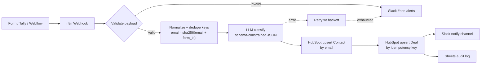

# leadflow-automation

Turn an inbound form submission into a qualified, deduplicated CRM deal — with LLM classification, retry/alert branches and a full audit trail.

## Business outcome

Sales teams lose leads in the gap between "form submitted" and "someone followed up". This workflow closes that gap:

| Before | After |
| --- | --- |
| Leads sit in an inbox until someone notices | Every submission becomes a tracked deal within seconds |
| Duplicate contacts from repeat submissions | Idempotent upsert — one contact, one deal |
| Everything is "high priority" | LLM classifies intent, ICP fit and urgency before routing |
| No one knows what the automation did | Every run written to an audit log |

## Architecture



### Flow nodes

| # | Node | Responsibility |
| --- | --- | --- |
| 1 | `Webhook` | Receives form POST, verifies shared secret |
| 2 | `Validate & Normalize` | Schema check: required fields, email format, phone normalization |
| 3 | `Dedupe keys` | Contact key = normalized email; deal key = sha256(email + form_id). Both applied through upsert, never search-then-create |
| 4 | `Classify` | OpenAI call with JSON Schema: `intent`, `icp_fit`, `urgency`, `summary` |
| 5 | `Upsert Contact` | HubSpot contact create-or-update, keyed by email |
| 6 | `Upsert Deal` | Create-or-update keyed by the idempotency key; only when `icp_fit >= threshold` |
| 7 | `Notify` | Slack message with a one-line summary (owner routing is out of scope) |
| 8 | `Audit` | Appends run id, payload hash, outcome, LLM output to Sheets |
| 9 | `Error branch` | Escalating backoff, then alert through the error workflow; never fails silently |

## Design notes

- **Idempotency** — contacts upsert by normalised email, deals upsert by a unique key (`sha256(email + form_id)`). A repeated submission updates, never duplicates, and replaying the same webhook is safe.
- **Backoff with a ceiling** — 3 retries at 2s / 8s / 30s, then a Slack alert carrying the run id and the masked payload.
- **Normalization before matching** — lowercased emails, E.164 phone numbers, company names stripped of legal suffixes (`Inc`, `Ltd`, `GmbH`). Dedupe is only as good as its normalization.
- **Structured LLM output** — the model returns a fixed JSON shape validated before use; on schema violation it falls back to rule-based defaults rather than writing garbage into the CRM.
- **Audit log as a first-class output** — payload hash + decision + model output, so any record in HubSpot can be traced back to the run that created it.
- **No silent side effects** — write operations are logged and reversible; failures route to a human.

## Stack

- **n8n** (self-hosted, Docker) — orchestration
- **PostgreSQL** — n8n persistence
- **OpenAI API** — classification with JSON Schema output
- **HubSpot** — CRM
- **Google Sheets** — audit log
- **Slack** — alerts and notifications

## Run

```bash
cp .env.example .env        # set N8N_VERSION and N8N_ENCRYPTION_KEY
docker compose up -d
open http://localhost:5678  # n8n UI
```

Then deploy the workflows and create the four credentials inside n8n:

```powershell
pwsh scripts/deploy-workflows.ps1 -DryRun   # inspect the credential mapping first
pwsh scripts/deploy-workflows.ps1
```

- Field-level contract (payload, hashing, CRM mapping, environment variables): [`reference/contract.md`](reference/contract.md)
- One-time setup and the acceptance runbook: [`reference/setup.md`](reference/setup.md)

## Repository layout

```
.
├── docker-compose.yml      # n8n + postgres
├── .env.example
├── workflows/              # exported n8n JSON, versioned
├── scripts/                # deploy + acceptance scripts
├── reference/              # integration contract + setup runbook
└── LICENSE
```

## License

MIT
